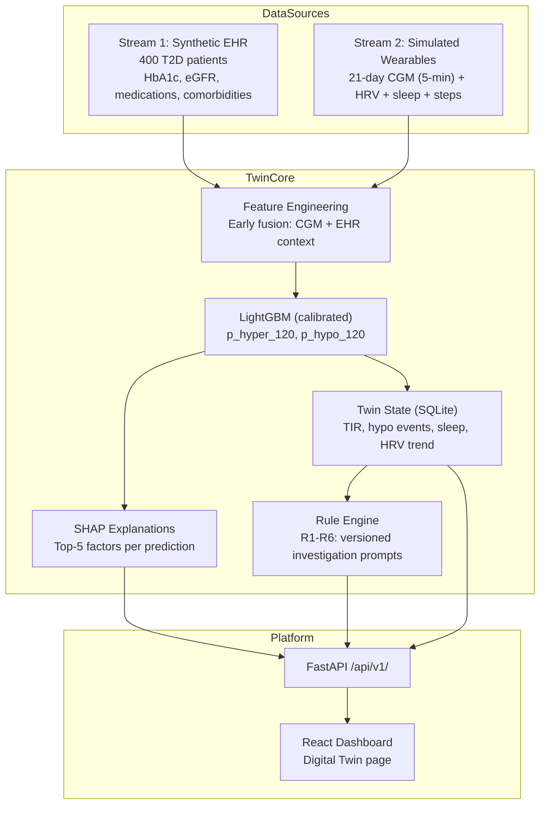

# MedAI — Digital Twin for Type 2 Diabetes

**A dual-stream Digital Twin for predicting glycaemic events in Type 2 Diabetes, with evidence-linked investigation support for clinicians.**

> **SYNTHETIC DATA — NOT FOR CLINICAL USE.**
> All patients and data in this system are entirely synthetic. MedAI is a proof-of-concept prototype built for the Digital Twin Challenge 2026 (Happiest Health). It is not a medical device, has not been clinically validated, and does not diagnose, prescribe, order or cancel tests. All clinical decisions remain with the treating clinician.

---

| | |
|---|---|
| **Project Name** | GlucoTwin |
| **College / Incubator** | [MAIT DELHI] |
| **Team leader** | Ayush Gupta |
| **Members** | [Ayush Gupta] · [Udiksha] · [Honey Priya] · [Vanshika Chauhan] |
| **Condition** | Type 2 Diabetes Mellitus (India) |
| **Challenge** | Digital Twin Challenge 2026 — Happiest Health |

---

## Contents

- [Problem Statement](#problem-statement)
- [Architecture](#architecture)
- [Data Sources and Limitations](#data-sources-and-limitations)
- [Model and Results](#model-and-results)
- [Investigation Rules](#investigation-rules)
- [Patient-Specific Clinical Guidance](#patient-specific-clinical-guidance)
- [How to Run](#how-to-run)
- [Tech Stack](#tech-stack)
- [License and Dataset Licences](#license-and-dataset-licences)
- [Safety Disclaimer](#safety-disclaimer)
- [Video and Slides](#video-and-slides)

---

## Problem Statement

Type 2 Diabetes is one of the most prevalent chronic conditions in India. Day-to-day glucose control is the part that most often slips between clinic visits: dangerous excursions happen in hours, while patients typically see a doctor every few months. At the same time, the clinician has no single consolidated view of which investigations are due.

MedAI addresses this by:

1. **Fusing two data streams** — a static EHR stream and a dynamic wearable stream — into one persistent virtual replica per patient.
2. **Predicting glycaemic events 2 hours ahead** — probability that glucose exceeds 180 mg/dL (hyperglycaemia) or drops below 70 mg/dL (hypoglycaemia).
3. **Explaining each alert** — SHAP-based top-5 contributing factors in plain language.
4. **Suggesting investigations** — versioned, evidence-linked rules that show what is due and why, never orders.
5. **Recording clinician decisions** — a full audit log of accept/defer/override decisions.

---

## Architecture



See [docs/ARCHITECTURE.md](docs/ARCHITECTURE.md) for the full diagram with all layers.

---

## Data Sources and Limitations

### Stream 1 — Synthetic EHR (Synthea-style)

- **Tool:** Python generator following Synthea CSV schema (`data/generate_ehr.py`)
- **Cohort:** 400 adult T2D patients, ages 30–80, fixed seed 42
- **Fields:** patient_id, age, sex, BMI, diabetes duration, comorbidities (hypertension, CKD stage 0–3), medications (metformin, sulfonylurea, insulin, DPP-4, SGLT-2 with hypoglycaemia risk flags), HbA1c history, eGFR, UACR, lipid profile, family history, synthetic genetic risk score
- **Synthea loader:** The generator follows the same CSV schema as Synthea exports. To use real Synthea output, replace the Parquet files in `data/` with Synthea CSVs processed by the documented schema mapping.

### Stream 2 — Simulated Wearable Time Series

- **Tool:** Physiologically inspired Python simulator (`data/simulate_wearable.py`)
- **Duration:** 21 days × 288 readings/day (5-min CGM)
- **Signals:** CGM glucose, heart rate, HRV (RMSSD), steps, sleep stages (0=awake/1=light/2=deep/3=REM)
- **Mechanisms:** baseline glucose from HbA1c eAG formula, post-meal gamma rise, dawn effect, exercise glucose drop, poor sleep raises next-day baseline, SU/insulin hypoglycaemia events, AR(1) noise, sensor dropout (NaN, never 0)

### Open Dataset References (optional sanity checks — not included in repo)

| Dataset | Access | Role |
|---|---|---|
| CGMacros (PhysioNet) | Open (check licence) | Optional real-signal pipeline check |
| BIG IDEAs Lab (PhysioNet) | Open (check licence) | Optional CGM + wearable sanity check |
| Synthea sample data | Apache 2.0 | Base schema reference |

### ⚠ Data Limitations

> Synthetic data cannot capture the full demographic, dietary, and care-pathway variation of Indian patients. Model scores on simulated signals reflect the simulator's assumptions. Results show the pipeline works end-to-end; they are not evidence of clinical effectiveness or generalisation to real Indian populations.

---

## Model and Results

### Task

At each forecast time t (every 15 minutes):
- **Input:** last 6 hours of CGM + wearable features + EHR context (32 features total)
- **Outputs:**
  - `p_hyper_120` — probability glucose > 180 mg/dL in the next 2 hours
  - `p_hypo_120` — probability glucose < 70 mg/dL in the next 2 hours

The hyper model is trained only on rows where current glucose ≤ 180 mg/dL (predicting onset, not continuation). Similarly for hypo model (current glucose ≥ 70 mg/dL).

### Feature Groups

| Group | Features | Stream |
|---|---|---|
| Glucose level and trend | Current value, lags at 15/30/60/120 min, slopes, rolling mean/SD/CV | CGM |
| Glucose context | Area above 140 mg/dL (2h), time since last rise, overnight min | CGM |
| Physiology and behaviour | Heart rate, HRV trend, steps (30/120 min), sleep duration, efficiency | Wearable |
| Time | Hour of day sin/cos | Derived |
| Patient context | Age, BMI, diabetes duration, HbA1c, eGFR, insulin/SU flag, comorbidities, genetic risk | EHR |

### Split

**Patient-wise 70/15/15** — no patient appears in two splits. Code asserts this in `twin/model_train.py:assert_no_leakage()`.

### Results (test patients only)

Evaluation was run against `data/dataset.parquet`. The tables below report
the metrics generated by the evaluation scripts; these are experimental
results, not evidence of clinical validation.

#### Headline evaluation metrics

| Target | AUROC | AUPRC | Brier Score | Positive Rate | Samples | Mean Lead Time |
|---|---:|---:|---:|---:|---:|---:|
| Hyperglycemia | 0.9192 | 0.8277 | 0.0652 | 25.73% | 54,946 | 14,279 min* |
| Hypoglycemia | 0.5000 | 0.0192 | 0.0192 | 1.92% | 114,440 | Not available |

*The reported hyperglycemia lead time is approximately 9.9 days. Its
interpretation depends on the evaluator's event and alert definitions and
should be verified before being described as a reliable prediction horizon.

#### Baseline comparison (AUROC)

| Target | Persistence | Linear Extrapolation |
|---|---:|---:|
| Hyperglycemia | 0.5000 | 0.5560 |
| Hypoglycemia | 0.5000 | 0.4984 |

AUPRC values for these baselines were not reported in `metrics.json`.

### Ablation Study

The ablation results compare input feature groups using AUROC and AUPRC.

| Target | Model / Feature Set | AUROC | AUPRC |
|---|---|---:|---:|
| Hyperglycemia | EHR only | 0.8538 | 0.6414 |
| Hyperglycemia | CGM only | 0.9520 | 0.8802 |
| Hyperglycemia | CGM + wearable | 0.9786 | 0.9408 |
| Hyperglycemia | Full fusion | 0.9789 | 0.9414 |
| Hypoglycemia | EHR only | 0.7260 | 0.0342 |
| Hypoglycemia | CGM only | 0.6366 | 0.0371 |
| Hypoglycemia | CGM + wearable | 0.7154 | 0.0446 |
| Hypoglycemia | Full fusion | 0.8264 | 0.0616 |

#### Evaluation caveat

The headline metrics in `results/metrics.json` do not match the corresponding
full-fusion results in `results/ablation.csv`. For example, hypoglycemia AUROC
is 0.5000 in the headline metrics and 0.8264 in the ablation output. These
results may reflect differences in evaluation paths or data processing.
They must not be treated as directly comparable until the implementation
is reconciled. The values above are reported as generated and have not been
independently validated.

The dataset is experimental. These metrics do not establish clinical safety,
generalization to real-world patients, or suitability for treatment decisions.
## Investigation Rules

All rules are review prompts only — never orders. Every rule carries `review_status: "pending clinician review"`.

| Rule | Trigger | Output | Source | Status |
|---|---|---|---|---|
| R1 HbA1c | Last HbA1c date | Due (>3–6 mo) / Recent | ADA Standards of Care | Pending clinician review |
| R2 Kidney | Last eGFR + UACR date | Annual check due / Recent | ADA Standards of Care | Pending clinician review |
| R3 Lipids | Last lipid profile date | Annual check due / Recent | ADA Standards of Care; Indian lipid guidance | Pending clinician review |
| R4 Eye + Foot | Last eye + foot exam dates | Referral reminder / Recent | ADA Standards of Care | Pending clinician review |
| R5 CGM-triggered | TIR < 70% or ≥ 2 hypo events / 14d | Therapy review flag | Battelino et al. 2019 (TIR consensus) | Thresholds: PLACEHOLDER — clinician-configurable |
| R6 Context override | Active high-risk alert or therapy change | Overrides 'Recent' → 'Review' | GlucoTwin safety design | Always active |

Rule intervals are documented placeholder defaults. Verify against ADA Standards of Care (current year), ICMR, and RSSDI before clinical use.

---

## Patient-Specific Clinical Guidance

The integrated MedAI platform includes a **Tests & Care Guidance** workflow
that prepares clinician-review suggestions using the selected patient's
available chart information.

### Information considered

- Documented diagnoses and their recorded details.
- Available laboratory results, units, reference ranges, and abnormal flags.
- Current prescriptions and available clinician notes.
- GlucoTwin short-term glucose-risk predictions, when available.

### How it works

- The backend prepares a rule-based draft from the available patient context.
- AI-assisted guidance can use local Ollama inference, such as `llama3.2`,
  or a configured hosted provider such as Groq.
- If AI inference is unavailable, the backend may fall back to rule-based guidance.
- The interface presents suggestions and precautions for clinician review.

### Important limitations

- Suggestions are not diagnoses, prescriptions, or automatic test orders.
- A clinician must verify the patient's record and decide what investigations
  or care are appropriate.
- Incorrect, synthetic, stale, or mismatched records can produce misleading
  suggestions. Verify units, reference ranges, dates, and critical results.
- Do not change treatment or delay emergency care based on AI output.

This is a prototype feature, not a clinically validated medical device.
It must not be used independently to make real patient-care decisions.

---

## How to Run

### Prerequisites

- Python 3.11+
- Node.js 20+ and npm
- Docker Desktop (for PostgreSQL + Redis)
- Git

### Three-command quick start

```bash
# 1. Start infrastructure + seed the database
docker compose up -d
cd backend && python -m alembic upgrade head && python -m app.seed && cd ..

# 2. Build the MedAI data + models (uses the 50-patient sample)
make demo

# 3. Start the backend and open a second terminal for the frontend
make api          # terminal 1 — http://localhost:8000
# In a second terminal:
cd frontend && npm install && npm run dev   # http://localhost:5173
```

### Login

```
Email:    admin@medintel.ai
Password: changeme123
```

**Security:** These are demo credentials only. Change or disable them before exposing a deployment publicly. Never commit `.env` files, API keys, database passwords, or production credentials.

Navigate to **Digital Twin** in the sidebar (Type 2 Diabetes module).

### Full pipeline

```bash
make data      # Generate full 400-patient dataset
make train     # Train LightGBM models
make eval      # Evaluate and produce results/metrics.json + figures
make test      # Run pytest suite
```

### Environment variables

Copy `backend/.env.example` to `backend/.env` and set `SECRET_KEY` to a random 64-character string:

```bash
python -c "import secrets; print(secrets.token_urlsafe(64))"
```

---

## Tech Stack

| Area | Choice | Why |
|---|---|---|
| Language | Python 3.11 | One language for data, model, API |
| EHR generation | Custom Synthea-style Python generator | Documented, reproducible, offline |
| Wearable simulation | NumPy, SciPy, Pandas | Controlled, correlated with EHR |
| Modelling | LightGBM + scikit-learn | Fast tabular baseline, works with SHAP |
| Explainability | SHAP | Per-prediction factor explanations |
| Backend | FastAPI, Pydantic, Uvicorn | Typed, async, excellent DX |
| Storage | PostgreSQL (existing) + SQLite (twin state) + Parquet (datasets) | Zero-setup demo, easy to scale |
| Frontend | React 19, TypeScript, Vite, Tailwind CSS v4, Recharts | Existing framework, extended not replaced |
| AI guidance | Ollama / optional hosted LLM provider and rule-based fallback | Clinician-facing draft guidance requiring review |
| Testing | pytest | Unit tests for every module |
| Packaging | Docker Compose, Makefile | One-command reproducible run |
| Interoperability | HL7 FHIR R4 mapping (design) | Path to real EHR integration |

---

## License and Dataset Licences

**Code:** MIT License (see [LICENSE](LICENSE))

**Data:** All data in this repository is synthetic. The Synthea schema is followed under the Apache 2.0 licence. Optional open datasets (CGMacros, BIG IDEAs Lab) are not included; check their PhysioNet licences before use.

---

## Safety Disclaimer

GlucoTwin is a student proof of concept built on synthetic data. It is **not a medical device** and has **not been clinically validated**.

- All investigation suggestions are labelled "pending clinician review"
- No investigation is ordered, cancelled, or modified automatically
- The clinician makes all decisions
- A real deployment would require clinical validation, regulatory review under applicable Indian medical device software requirements, and appropriate privacy and data governance

---

## Video and Slides

- **Video (20 min):** [Link to be added before submission]
- **Presentation (PDF/PPT):** [Link to be added before submission]
- **Architecture diagram:** `docs/ARCHITECTURE.md`

---

## Integrated MedAI Platform

This repository integrates:

1. **Original Hospital Analytics** (existing MedIntel AI)
   - Executive Dashboard — hospital KPIs, admissions trend, ward distribution
   - ICU Risk Check — XGBoost-based ICU admission risk for admitted patients
   - Patient Management — CRUD with RBAC (admin/doctor/nurse/researcher roles)

2. **Digital Twin Module** (new for Digital Twin Challenge 2026)
   - Type 2 Diabetes dual-stream Digital Twin
   - Glycaemic event prediction (hyper/hypo 2-hour forecast)
   - Evidence-linked investigation suggestions
   - Clinician audit trail

Both modules extend the MedAI platform without modifying existing functionality.

---

---

**MedAI** — Intelligent Healthcare Analytics & Predictive Care Platform  
*Synthetic data only. Not for clinical use.*
