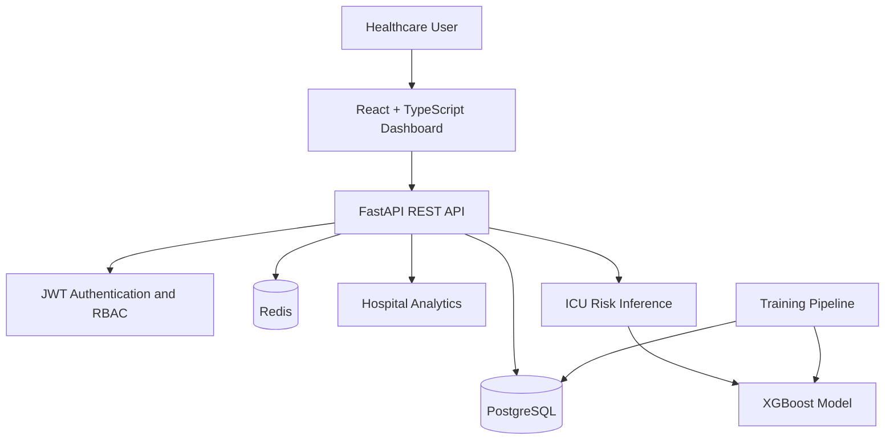

# MedIntel AI
### Intelligent Healthcare Analytics & Predictive Care Platform

MedIntel AI is a healthcare analytics prototype designed to bring patient management, hospital operations insights, and machine-learning-assisted ICU admission risk estimation into one platform.

It combines a React dashboard with a FastAPI backend, relational data storage, authenticated APIs, and an ML inference pipeline to demonstrate how healthcare teams could explore patient information and identify cases that may warrant closer clinical attention.

> **Project status:** Prototype / development project. The ICU risk model uses synthetic data and is not clinically validated. This project is not intended for real-world diagnosis, treatment decisions, or deployment with identifiable patient data.

---

## Contents

- [Key Features](#key-features)
- [Architecture](#architecture)
- [Technology Stack](#technology-stack)
- [Project Structure](#project-structure)
- [Getting Started](#getting-started)
- [Configuration](#configuration)
- [Machine Learning Pipeline](#machine-learning-pipeline)
- [API Overview](#api-overview)
- [Authentication and Roles](#authentication-and-roles)
- [Security and Data Privacy](#security-and-data-privacy)
- [Known Limitations](#known-limitations)
- [Future Improvements](#future-improvements)

---

## Key Features

### Executive Hospital Dashboard
- Patient and admission overview
- Bed occupancy and capacity indicators
- Patient registration trends
- Ward distribution and diagnosis summaries
- Analytics delivered through a protected API

### Patient Management
- Patient demographics and medical record identifiers
- Patient listing and record management
- Clinical information models for diagnoses, prescriptions, laboratory results, and doctor notes
- Role-aware access to patient operations

### ICU Admission Risk Estimation
- Feature engineering from patient and clinical measurements
- XGBoost-based classification pipeline
- Estimated ICU admission probability
- Low, medium, and high risk categories
- Contributing-factor hints for model predictions

Risk estimates are intended for prototype demonstration and research. They must not be interpreted as validated clinical assessments.

### Authentication and Access Control
- User registration and login
- JWT-based authentication
- Access-token refresh flow
- Role-based authorization
- Google OAuth integration scaffold

Google OAuth requires valid credentials and configuration. Multi-factor authentication is not yet fully implemented.

---

## Architecture



### Component responsibilities

| Component | Responsibility |
|---|---|
| Frontend | Dashboard, login, patient views, and ICU risk interface |
| FastAPI | REST endpoints, validation, authentication, and application logic |
| PostgreSQL | Users, patient records, and clinical event data |
| Redis | Local supporting service; application-level usage may require further integration |
| SQLAlchemy + Alembic | Database models and schema migrations |
| ML pipeline | Feature preparation, model training, and risk inference |
| Docker Compose | Local PostgreSQL and Redis services |

---

## Technology Stack

**Frontend**
- React
- TypeScript
- Vite
- React Router
- Axios
- Recharts
- Tailwind CSS

**Backend**
- Python
- FastAPI
- Pydantic
- SQLAlchemy
- Alembic
- PostgreSQL
- Redis

**Machine Learning**
- XGBoost
- scikit-learn
- pandas
- NumPy
- joblib

**Authentication and infrastructure**
- JWT
- OAuth integration scaffold
- Docker Compose
- PostgreSQL migrations

---

## Project Structure

```text
medai/
├── backend/
│   ├── app/
│   │   ├── core/          # Configuration, security, dependencies
│   │   ├── db/            # Database session and connection
│   │   ├── ml/            # Features, training, inference
│   │   ├── models/        # User and clinical data models
│   │   ├── routers/       # Authentication, patients, analytics, ML
│   │   ├── schemas/       # API request and response schemas
│   │   ├── tests/         # Test package
│   │   ├── main.py        # FastAPI entry point
│   │   └── seed.py        # Synthetic demo data
│   ├── alembic/           # Database migrations
│   ├── .env.example       # Backend configuration template
│   └── requirements.txt
├── frontend/
│   ├── src/
│   │   ├── components/    # Reusable UI components
│   │   ├── lib/           # API client, auth, and types
│   │   ├── pages/         # Login, dashboard, patients, ICU risk
│   │   ├── App.tsx
│   │   └── main.tsx
│   ├── .env.example       # Frontend configuration template
│   └── package.json
├── docker-compose.yml
├── .gitignore
└── README.md
```

---

## Getting Started

### Prerequisites

Install the following tools:

- Git
- Python 3.11 or a compatible version
- Node.js and npm compatible with the frontend dependencies
- Docker Desktop with Docker Compose

### 1. Clone the repository

```bash
git clone git@github.com:ayush2459/medai.git
cd medai
```

### 2. Start PostgreSQL and Redis

From the project root:

```bash
docker compose up -d
docker compose ps
```

The development configuration exposes PostgreSQL on port `5432` and Redis on port `6379`.

The included database credentials are for local development only. Do not reuse them in production.

### 3. Configure the backend

```bash
cd backend

python3 -m venv .venv
source .venv/bin/activate

pip install -r requirements.txt
cp .env.example .env
```

On Windows, activate the environment with:

```powershell
.venv\Scripts\activate
```

Generate a strong development secret:

```bash
python -c "import secrets; print(secrets.token_urlsafe(64))"
```

Put the generated value in `backend/.env` as `SECRET_KEY`. Keep this file private.

### 4. Apply database migrations and seed demo data

With the backend virtual environment activated:

```bash
python -m alembic upgrade head
python -m app.seed
```

The seed script creates synthetic users, patient records, and clinical data for development. Review the seed script before running it against any database containing information you need to preserve.

### 5. Train the ICU risk model

From the `backend/` directory:

```bash
python -m app.ml.train_icu_risk
```

The training process uses the available seeded clinical data and saves the trained model under `app/ml/models/`.

Training results on synthetic data are not evidence of clinical performance or generalization to real patients.

### 6. Start the backend

From `backend/`:

```bash
python -m uvicorn app.main:app --reload --port 8000
```

Useful local endpoints:

- API documentation: http://localhost:8000/docs
- OpenAPI schema: http://localhost:8000/openapi.json
- Health check: http://localhost:8000/api/health

### 7. Start the frontend

Open a second terminal:

```bash
cd frontend
npm install
cp .env.example .env
npm run dev
```

Open http://localhost:5173.

The frontend environment variable `VITE_API_BASE_URL` should point to the backend base URL, normally `http://localhost:8000` for local development.

### 8. Demo login

The seed script documents a demo account:

- Email: `admin@medintel.ai`
- Password: `changeme123`

Use these credentials only with a local database populated by the seed script. Change or remove demo credentials before any shared or deployed environment.

---

## Configuration

### Backend environment variables

| Variable | Purpose |
|---|---|
| `DATABASE_URL` | PostgreSQL connection string |
| `REDIS_URL` | Redis connection string |
| `SECRET_KEY` | JWT signing and session secret |
| `ALGORITHM` | JWT signing algorithm |
| `ACCESS_TOKEN_EXPIRE_MINUTES` | Access-token lifetime |
| `REFRESH_TOKEN_EXPIRE_DAYS` | Refresh-token lifetime |
| `OAUTH_GOOGLE_CLIENT_ID` | Optional Google OAuth client ID |
| `OAUTH_GOOGLE_CLIENT_SECRET` | Optional Google OAuth secret |
| `OAUTH_REDIRECT_URL` | OAuth callback URL |
| `CORS_ORIGINS` | Allowed frontend origins |
| `TOTAL_BED_CAPACITY` | Capacity used for occupancy analytics |

See `backend/.env.example` for the complete template.

### Frontend environment variables

| Variable | Purpose |
|---|---|
| `VITE_API_BASE_URL` | Backend API base URL |

See `frontend/.env.example`.

Never commit actual `.env` files, API tokens, private keys, production connection strings, or patient data.

---

## Machine Learning Pipeline

The ICU risk workflow consists of three main stages:

1. **Feature engineering:** prepares supported clinical measurements and patient features.
2. **Training:** fits an XGBoost classifier using available admission-event labels.
3. **Inference:** estimates the probability of an ICU admission event and maps the result to a risk category.

The API exposes a patient-level ICU risk endpoint. Its exact response fields and access restrictions are defined in the backend implementation and OpenAPI documentation.

### Important model caveats

- Training labels and clinical correlations in the included seed data are synthetic.
- Model evaluation on synthetic data does not establish safety, fairness, calibration, or clinical usefulness.
- Contributing-factor hints use a lightweight feature-importance approach, not a validated per-patient explanation method.
- The project does not yet provide a complete model registry, drift monitoring, or clinical validation workflow.

Clinical use would require representative data, independent evaluation, privacy controls, clinician review, and appropriate regulatory and governance assessment.

---

## API Overview

The backend groups its endpoints by application responsibility.

| Area | Purpose |
|---|---|
| Authentication | Registration, login, token refresh, and current-user information |
| OAuth | Google login integration scaffold |
| Patients | Patient record operations |
| Analytics | Executive dashboard metrics |
| Machine learning | ICU admission risk estimates |
| Health | Backend health check |

The patient risk endpoint is:

```http
GET /api/ml/icu-risk/{patient_id}
```

Protected endpoints require the authentication scheme expected by the API, typically a bearer access token.

For current request schemas, response examples, and endpoint details, start the backend and open `/docs`.

---

## Authentication and Roles

The backend defines four roles:

| Role | Intended access |
|---|---|
| Admin | Administrative and broad patient-management access |
| Doctor | Clinical workflows and patient care information |
| Nurse | Permitted patient and clinical workflows |
| Researcher | Restricted access for research and population analytics |

Permissions are enforced by backend dependencies and endpoint rules, not merely by hiding frontend controls. Check each endpoint's implementation before relying on a particular permission.

---

## Security and Data Privacy

This repository is a development prototype. Before deploying it or connecting real healthcare systems:

- Use strong, unique secrets and rotate any exposed credentials.
- Enforce HTTPS and secure cookie/session settings.
- Configure restrictive CORS origins and production database access.
- Validate authentication, authorization, and audit logging.
- Store secrets in a managed secret store rather than source control.
- Use de-identified or synthetic data in development.
- Review retention, access, encryption, backup, and incident-response requirements.
- Obtain appropriate clinical, privacy, and security review before processing real patient data.

Do not use the demo seed account or local database credentials in a public deployment.

---

## Known Limitations

- The included data is synthetic and intended for demonstrations.
- ICU risk predictions are not clinically validated.
- Google OAuth requires provider credentials and correct callback configuration.
- Multi-factor authentication fields exist, but full TOTP verification is not implemented.
- Some analytics and clinical workflows may require further development before production use.
- Automated test coverage, model monitoring, and production deployment hardening remain areas for improvement.

---

## Future Improvements

Potential next steps include:

- Automated backend and frontend tests in CI
- Production-grade secret management and deployment configuration
- More complete clinical event and audit workflows
- Model evaluation on approved, representative datasets
- Model versioning, drift monitoring, and reproducible training
- Stronger accessibility and usability testing
- Observability, backups, and operational runbooks

---

## Contributing

1. Fork the repository or create a feature branch.
2. Make a focused change.
3. Run the relevant checks and tests.
4. Keep credentials and sensitive data out of commits.
5. Open a pull request describing the change and its validation.

## License

No license has been specified yet. Unless a license is added, reuse and redistribution are subject to the default applicable copyright rules.

---

**MedIntel AI** — a prototype exploring the intersection of healthcare operations, clinical data, and machine-learning-assisted risk estimation.
