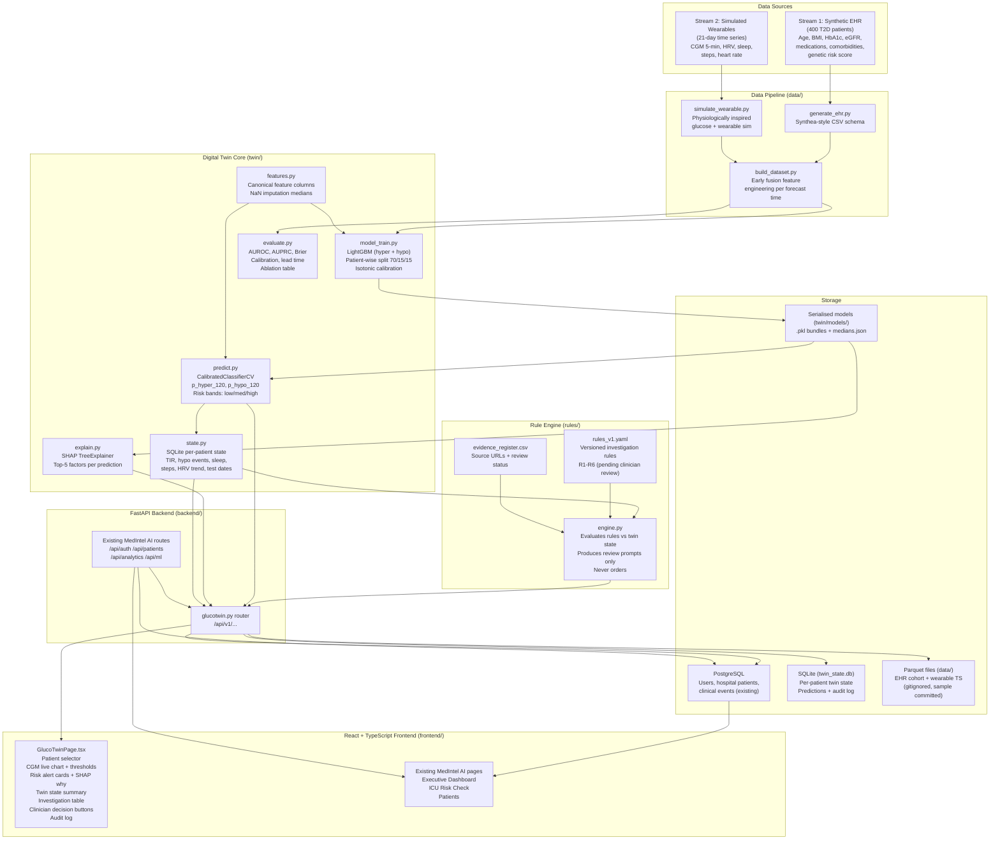

# GlucoTwin — System Architecture

## Mermaid Diagram

## Layer Descriptions

| Layer | Files | Responsibility |
|---|---|---|
| Data Sources | `data/generate_ehr.py`, `data/simulate_wearable.py` | Generate 400 synthetic T2D patients + 21 days wearable data |
| Feature Engineering | `data/build_dataset.py`, `twin/features.py` | Early fusion of CGM features + EHR context per forecast time |
| Twin Core | `twin/state.py`, `twin/model_train.py`, `twin/predict.py`, `twin/explain.py` | Per-patient persistent state, LightGBM prediction, SHAP explanations |
| Evaluation | `twin/evaluate.py` | AUROC/AUPRC/Brier/calibration/lead-time + ablation table |
| Rule Engine | `rules/engine.py`, `rules/rules_v1.yaml` | Versioned investigation suggestions (never orders) |
| API | `backend/app/routers/glucotwin.py` | 12 REST endpoints at `/api/v1/` |
| Frontend | `frontend/src/pages/GlucoTwinPage.tsx` | Clinician dashboard: CGM chart, risk cards, investigations, audit log |
| Storage | PostgreSQL + SQLite + Parquet | Separated: relational (existing), twin state (SQLite), datasets (Parquet) |

## Data Flow

1. EHR generator creates 400 synthetic T2D patients (Parquet)
2. Wearable simulator generates 21 days × 288 CGM readings per patient (Parquet)
3. Dataset builder merges both streams into forecast-ready feature rows (Parquet)
4. LightGBM trains on 70% of patients (patient-wise split), validates on 15%, tests on 15%
5. Calibrated models saved to `twin/models/*.pkl`
6. API loads patient data from Parquet cache; builds features on demand
7. Rule engine reads twin state from SQLite and evaluates against `rules_v1.yaml`
8. Frontend polls `/api/v1/twin/{patient_id}` and displays everything in one screen

## Safety Design

- All data is synthetic (no real patient data)
- Every alert shows SHAP top-5 factors
- Every investigation suggestion is labelled "pending clinician review"
- Every suggestion carries rule ID, version, and source URL
- Missing data returns "missing_data" status, never a guess
- R6 (context override) is always active: recent lab results do not suppress
  suggestions when a high-risk alert or therapy change is active
- Clinician decisions (accept/defer/override) are stored in an audit log
- A persistent "SYNTHETIC DATA — NOT FOR CLINICAL USE" banner is shown at all times
